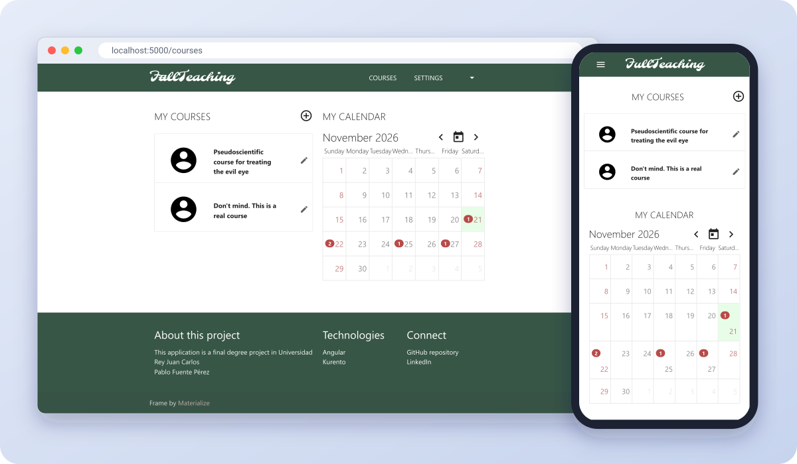
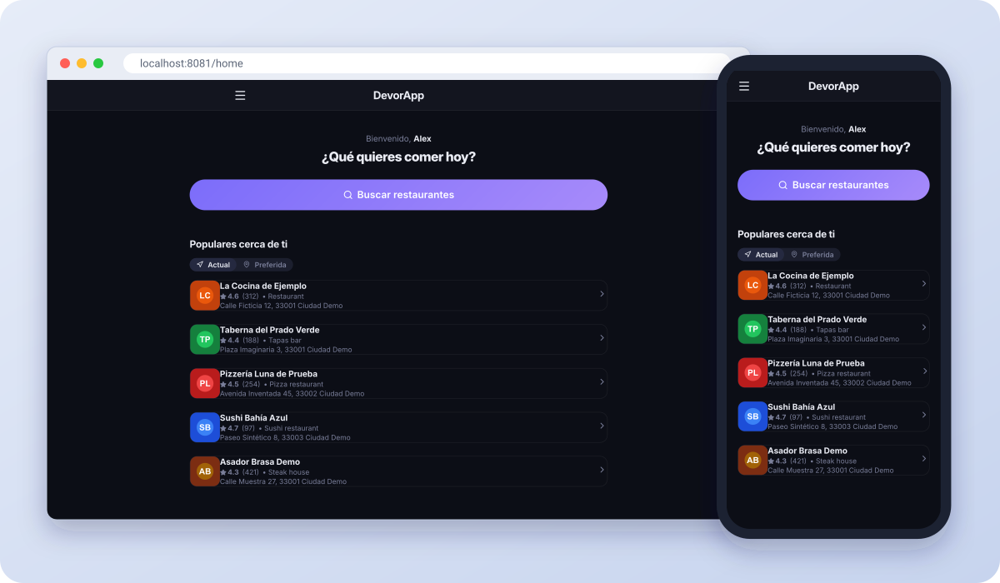
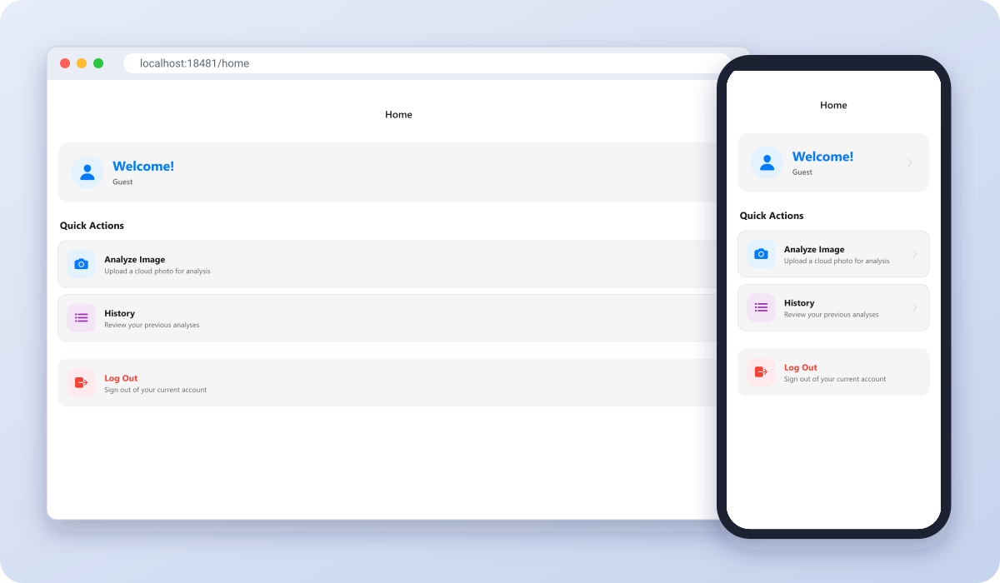

# giise2ebench
GIISE2EBench: a benchmark of E2E test suites with their applications

## Demonstrators

Each demonstrator is a system under test (SUT) together with its end-to-end test suite, included as a Git submodule.

### FullTeaching

FullTeaching is an educational web application that makes online classes easy for teachers and students: courses, sessions, a forum per course, file sharing and video-conference classes through OpenVidu (Angular and Spring Boot).

Repository: [giise2ebench-st-fullteaching](https://github.com/augustocristian/giise2ebench-st-fullteaching) (submodule [`giise2ebench-st-fullteaching`](giise2ebench-st-fullteaching))

### DevorApp

DevorApp is a restaurant discovery and recommendation app (React and Capacitor frontend, FastAPI backend, PostgreSQL and a Keras recommendation service).

Repository: [giise2ebench-st-devorapp](https://github.com/augustocristian/giise2ebench-st-devorapp) (submodule [`giise2ebench-st-devorapp`](giise2ebench-st-devorapp))

### ClimaNuvem

ClimaNuvem is a mobile application that analyses cloud photographs and generates a short-term local weather forecast (Expo and React Native app, FastAPI backend, Firebase authentication, PostgreSQL and a multimodal model served by Ollama).

Repository: [giise2ebench-st-climanuvem](https://github.com/augustocristian/giise2ebench-st-climanuvem) (submodule [`giise2ebench-st-climanuvem`](giise2ebench-st-climanuvem))

---

  

